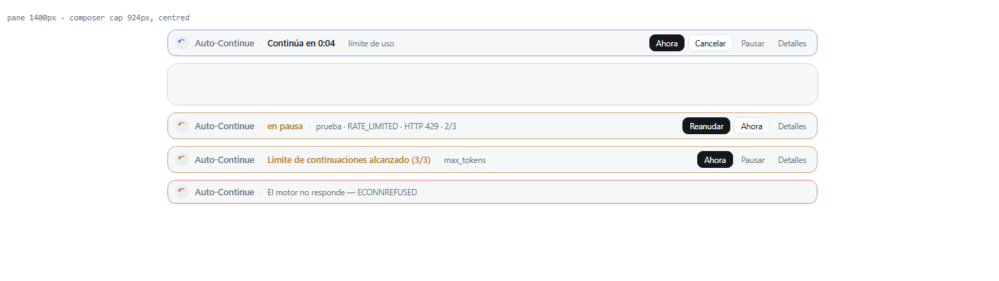

# Continuación automática (ES / EN)

Mantiene una sesión de DeepSeek Harness en marcha cuando un turno termina antes de que el trabajo
esté hecho, y pone un panel al estilo de Claude Code justo encima del compositor para que veas
venir la continuación y puedas pararla.

Un turno puede cortarse por motivos que no tienen nada que ver con la tarea: el modelo llegó a su
límite de salida, el proveedor cerró una ventana de uso, se cayó la conexión o un reinicio dejó el
turno huérfano. Continuación automática observa el registro de la sesión, decide si ese final es
recuperable y —tras una espera breve— devuelve el trabajo a su cauce con un mensaje de usuario
normal.

Los textos vienen en **inglés y español** uno al lado del otro; no hay traducción en tiempo de
ejecución: lo que lees en el código es lo que se envía (`language: auto` sigue el idioma del
sistema y recae en inglés). La interfaz sigue el idioma de la aplicación del mismo modo.

## El panel

Dos superficies, ambas construidas solo con tokens del tema, así que respetan el modo claro y el
oscuro:

- **Banda sobre el compositor** (`conversation.input.dock`, orden 30). Mientras hay una
  continuación en cola hace la cuenta atrás — `Continuará en 0:04`, o `Se reabre en 0:04` cuando lo
  que se espera es que se reabra una ventana de Command Code — y ofrece `Ahora`, `Cancelar` y
  `Pausar`. Cuando se detiene, dice por qué (tope alcanzado, guardia de bucle, pausa) y sigue
  ofreciendo `Ahora`. `Detalles` despliega el último final, la racha actual, las ventanas de uso con
  su hora de restablecimiento y un rastro corto de las decisiones del motor. Si no hay nada que
  contar, la banda no se dibuja.
- **Página de ajustes** (`settings.section`, orden 13, «Continuación automática»). Tarjeta de estado
  con pausar/reanudar y la ruta del almacén, una tarjeta de Command Code con las ventanas de uso, su
  hora de restablecimiento y el crédito que queda, todos los interruptores, todos los tiempos, los
  umbrales de las protecciones, un área de texto por cada mensaje de continuación (marcador = el
  texto de serie) y la lista de sesiones con una continuación pendiente. Los cambios se preparan en
  un borrador: `Guardar` los escribe, `Descartar cambios` los tira, y el sondeo de estado cada 1,5 s
  nunca pisa lo que no has guardado.

Las dos superficies hablan con la mitad de host por `/api/dsh-auto-continue/state` y
`/api/dsh-auto-continue/action`, registradas sobre el transporte HTTP del perfil. Si el perfil no
tiene transporte, el motor sigue funcionando; solo falta el panel.



## Probarlo sin gastar cuota

La banda solo aparece cuando el motor tiene una continuación en cola, y esperar a que se agote una
ventana de uso para verla no es una forma de trabajar. Hay dos disparadores:

**La orden.** Escríbela en el compositor:

```
/auto-continue simular limite 10
```

Arma una continuación falsa y la banda aparece en esa sesión. «10» son los segundos de cuenta atrás
(8 por defecto) y no se envía nada. Añade `enviar` para que además mande el texto de verdad:

```
/auto-continue simular error 5 enviar
```

Motivos: `tokens` (o `max-tokens`), `limite` (o `rate-limit`), `error`, `interrumpido`
(o `interrupted`), `completado`, `manual`. Las formas en inglés (`drill rate-limit`) también valen.

**Los botones.** La página de ajustes tiene una tarjeta «Probar la banda» con un botón por motivo, un
campo de segundos y la casilla «Enviarla de verdad». Hacen lo mismo que la orden, sin nada que
escribir.

La prueba se marca como tal: la banda lleva la etiqueta `prueba` y el rastro guarda `drill` en vez de
`armed`, así que nunca confundes una prueba con un límite real.

El resto de la orden, útil sin panel:

| Orden | Efecto |
| --- | --- |
| `/auto-continue estado` | Racha, último final y si hay algo armado. |
| `/auto-continue ahora` | Envía ya la continuación pendiente (o una manual). |
| `/auto-continue pausar` / `reanudar` | Pausa global, persistente. |
| `/auto-continue cancelar` | Desarma sin enviar. |
| `/auto-continue reiniciar` | Olvida el estado de la sesión. |
| `/auto-continue` | Ayuda. |

## Qué continúa

| Motivo de fin de turno | Por defecto | Qué significa                                                        |
| ---------------------- | ----------- | -------------------------------------------------------------------- |
| `max-tokens`           | activo      | El modelo alcanzó su límite de salida a mitad de respuesta.           |
| `interrupted`          | activo      | Un reinicio dejó el turno huérfano y se cerró al reanudar la sesión.  |
| `rate-limit`           | activo      | El proveedor cerró una ventana de uso (planes de Command Code); espera. |
| `error`                | activo      | Fallo recuperable del proveedor (5xx, timeout, corte).                |
| `completed`            | **apagado** | El modelo paró solo; esto convierte la sesión en un bucle.            |

Nunca se continúa, diga lo que diga la configuración:

- un turno que detuviste tú (`aborted` con causa `user`),
- un turno bloqueado por un hook previo (`blocked`),
- un turno bifurcado a otra sesión (`forked`),
- las sesiones de subagente.

### Command Code

El plugin se construyó alrededor de [Command Code](https://github.com/Mars-Sea/dsh-commandcode-provider),
el proveedor para el que se escribió. Una ventana de plan agotada llega como un fallo `RATE_LIMITED`
cuyo mensaje dice que la ventana más cercana «resets at <ISO>»; cuando el restablecimiento está
próximo el proveedor adjunta además `providerRetryAfterMs`. Continuación automática lo convierte en
una espera `rate-limit`: continúa justo después del restablecimiento publicado en vez de gastar
intentos contra una ventana cerrada, y nunca trata «usage limit for your plan» como error
permanente. `rateLimitWaitMs` acota hasta dónde está dispuesto a programar.

El plugin lee además el informe de uso del propio proveedor — el mismo Remote que usa su panel,
`remote.commandcode` → `report()` — así que el panel enseña cifras reales en vez de adivinar:

| Se muestra | De dónde sale |
| --- | --- |
| `Ventana de 5 horas`, `Ventana semanal` — porcentaje usado, `usado/tope`, `Agotada` | `credits.fiveHour` / `credits.weekly` de cada cuenta |
| `Se restablece 18:40` | el `resetAt` de esa ventana, en hora local (`+1d` si pasa de medianoche) |
| `Crédito mensual · Comprado · Gratis` | `credits.monthlyCredits`, `purchasedCredits`, `freeCredits` |
| Nombre del plan | `plan.name` |

La banda enseña el porcentaje y el restablecimiento de la ventana que explica la espera — la agotada
si el proveedor lo dice, si no la que se restablece antes — y pone `Se reabre en 0:04` en lugar de
`Continuará en 0:04` mientras espera ese momento. La tarjeta de ajustes tiene un botón `Actualizar` y
anota de cuándo es la lectura. Si el proveedor no está instalado la tarjeta lo dice y nada más
cambia: el motor sigue funcionando, solo que no puede enseñar las ventanas.

## Protecciones

- **Tope de continuaciones** (`maxConsecutive`, 3): tras tres continuaciones seguidas sin que
  escribas nada, el plugin se detiene. Cualquier mensaje tuyo reinicia el contador.
- **Los errores permanentes no se reintentan** (auth, credenciales, API key, saldo, sin créditos,
  facturación, modelo desconocido, desbordamiento de contexto, filtro de contenido, petición mal
  formada) y tampoco los HTTP 401/403. Desactiva `classifyErrors` solo si quieres reintentarlos.
- **Espera exponencial**: `cooldownMs × backoffFactor^n`, limitada por `backoffMaxMs`; si el
  proveedor indica su propio `providerRetryAfterMs`, ese valor manda.
- **Guardia de bucle**: si el asistente devuelve la misma respuesta `loopRepeatLimit` turnos
  seguidos, el plugin se detiene en vez de girar en vacío.
- **Espera de cortesía** (`graceMs`, 3000 ms): una pausa breve antes de continuar, que se cancela
  en cuanto escribes o la sesión inicia un turno nuevo.
- **Los temporizadores son por sesión** y se limpian cuando la sesión se libera o el plugin se
  descarga.

## Configuración

### Cómo se cambian los ajustes

Desde la página de ajustes (Ajustes → Continuación automática) o desde la banda. Los valores se
guardan en `<DSH_HOME>/auto-continue.json` y se aplican al momento, sin reiniciar:

```json
{ "version": 1, "paused": false, "overrides": { "language": "es", "maxConsecutive": 5 } }
```

La prioridad es **almacén → fila del parche → valor de serie**, así que lo que editas en la página
manda sobre el parche del perfil. El parche sigue siendo la forma de llevar valores no
predeterminados a un perfil nuevo:

```yaml
- id: dsh-auto-continue
  config:
    language: es
    maxConsecutive: 5
    textMaxTokens: Sigue desde donde lo dejaste.
```

Todas las claves son opcionales: lo que no escribas conserva su defecto, y un valor inválido se
acota en vez de rechazarse, así que una errata nunca deja el plugin en un estado en el que no pueda
arrancar. Al arrancar, el plugin escribe una línea `ready — …` con los ajustes que resolvió y otra
cuando el panel queda montado.

### Claves

| Clave | Tipo | Defecto | Descripción |
| --- | --- | --- | --- |
| `enabled` | boolean | `true` | Continúa los turnos automáticamente. Apagado, el plugin queda inactivo. |
| `language` | string | `auto` | Idioma de los textos: `auto`, `es` o `en`. `auto` sigue el idioma del sistema y cae a inglés. |
| `continueOnMaxTokens` | boolean | `true` | Continuar en `max-tokens`. |
| `continueOnInterrupted` | boolean | `true` | Continuar cuando un turno huérfano se cierra como `interrupted`. |
| `continueOnError` | boolean | `true` | Continuar tras un error recuperable, incluida una ventana de uso cerrada. |
| `continueOnCompleted` | boolean | `false` | Continuar tras un final normal (bucle autónomo). |
| `textMaxTokens` | string | `""` | Texto propio para `max-tokens`. Vacío usa el de serie. |
| `textInterrupted` | string | `""` | Texto propio para `interrupted`. Vacío usa el de serie. |
| `textError` | string | `""` | Texto propio para `error`. Vacío usa el de serie. |
| `textRateLimit` | string | `""` | Texto propio para `rate-limit`. Vacío usa el de serie. |
| `textCompleted` | string | `""` | Texto propio para `completed`. Vacío usa el de serie. |
| `rateLimitWaitMs` | number | `900000` | Hasta dónde se puede programar una ventana de uso, con tope de 6 h. |
| `graceMs` | number | `3000` | Espera antes de continuar, para que puedas intervenir. |
| `cooldownMs` | number | `20000` | Espera base antes de reintentar tras un error. |
| `backoffFactor` | number | `2` | Multiplicador por cada fallo consecutivo. |
| `backoffMaxMs` | number | `300000` | Tope de la espera exponencial. |
| `maxConsecutive` | number | `3` | Continuaciones seguidas sin intervención tuya. |
| `classifyErrors` | boolean | `true` | Detenerse en vez de reintentar errores permanentes. |
| `loopGuard` | boolean | `true` | Detenerse cuando el asistente repite la misma respuesta. |
| `loopRepeatLimit` | number | `4` | Respuestas idénticas seguidas que cuentan como bucle. |
| `verbose` | boolean | `false` | Escribir cada decisión en el registro del host. |

### Marcadores en un texto propio

`{reason}` · `{code}` · `{status}` · `{message}` · `{turn}` · `{count}` · `{limit}` · `{elapsed}`

Los marcadores desconocidos se dejan tal cual, así que unas llaves en texto normal no rompen nada.

## Textos de serie

**Español**

- `max-tokens`: *Continúa exactamente donde te quedaste, sin repetir lo que ya está hecho.*
- `interrupted`: *Retoma la tarea interrumpida y continúa desde el último paso completado.*
- `rate-limit`: *La petición anterior chocó con el límite de uso del proveedor ({code}). La ventana ya se ha reabierto: retoma la tarea exactamente donde se quedó.*
- `error`: *El intento anterior falló por un error recuperable ({code}). Reintenta el último paso y continúa la tarea.*
- `completed`: *Continúa con el siguiente paso pendiente de la tarea.*
- manual (`Ahora`): *Continúa con la parte pendiente de la tarea.*

**Inglés**

- `max-tokens`: *Continue exactly where you left off, without repeating work that is already done.*
- `interrupted`: *Resume the interrupted task and continue from the last completed step.*
- `rate-limit`: *The previous request hit the provider usage limit ({code}). The window is open again: resume the task exactly where it stopped.*
- `error`: *The previous attempt failed with a recoverable error ({code}). Retry the last step and continue the task.*
- `completed`: *Continue with the next pending step of the task.*
- manual (`Ahora`): *Continue with the pending part of the task.*

## Cómo funciona

```
turn/end (confirmado)  →  decidir(motivo, config, estado)
                           ├─ no recuperable → descartar (y decirlo en la banda)
                           ├─ en pausa / tope / guardia de bucle → detenerse
                           └─ recuperable    → esperar delayMs (cortesía / espera / reinicio de ventana)
                                                 └─ agent.followup(mensaje de usuario)
```

La continuación es un mensaje `user` normal con `source: { kind: 'user' }`, entregado por la
bandeja del propio agente con `agent.followup()`: el mismo camino que enviar un mensaje en cola
desde el compositor. El registro de la sesión lo guarda como cualquier otro mensaje y el modelo lo
ve como cualquier otro mensaje. El plugin marca sus propios mensajes para distinguirlos de los
tuyos: tu mensaje reinicia la racha, su propia continuación no.

Los contadores y temporizadores viven en memoria, por sesión, y se reconstruyen a partir del flujo
de eventos; lo único que queda en disco es el almacén de ajustes de arriba (`paused` y tus
sobrescrituras).

## API HTTP

Las dos rutas van sobre el transporte HTTP del perfil y las escrituras exigen la cabecera de
mutación:

| Ruta | Método | Para qué |
| --- | --- | --- |
| `/api/dsh-auto-continue/state?session=<id>` | GET | Configuración efectiva, textos, ruta del almacén y foto de la sesión. |
| `/api/dsh-auto-continue/action` | POST | `pause`, `resume`, `continue-now`, `cancel`, `reset`, `save` (`{ action, config }`), `simulate` (`{ action, session?, reason?, delayMs?, deliver? }`). |

El `POST` exige la cabecera `x-dsh-auto-continue: 1`; sin ella la ruta responde `403`.

## Sobre el desbordamiento de contexto

Un error de longitud de contexto se trata como permanente a propósito: reintentarlo vuelve a
fallar. Si ese caso debería compactar y luego continuar es una decisión de producto; este plugin
deja la compactación en manos del plugin de compactación en vez de lanzarla en silencio.

## Licencia

MIT. El icono es un dibujo original creado para este plugin.

## Inspirado en

- [HsiangNianian/dsh-auto-continue](https://github.com/HsiangNianian/dsh-auto-continue) — motor por eventos, espera exponencial, clasificación de errores permanentes, guardia de bucle.
- [weibaohui/dsh-continue](https://github.com/weibaohui/dsh-continue) — tabla de reglas ordenada, respeto del `retryAfter` del proveedor, respeto de la parada manual.
- [qwert702/dsh-continue-on-limit](https://github.com/qwert702/dsh-continue-on-limit) — tratamiento mínimo de `max-tokens` con poca superficie de configuración.
