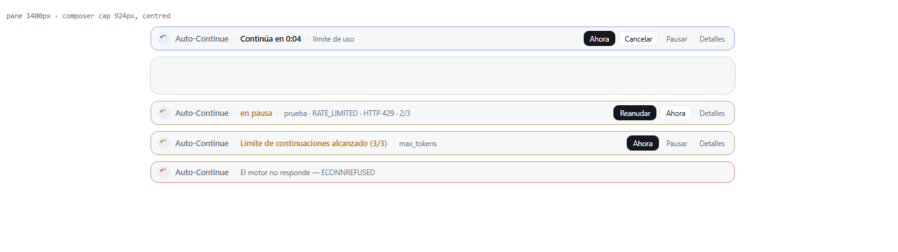

# Auto-Continue (EN / ES)

[](https://github.com/Zarpyk/dsh-auto-continue/actions/workflows/ci.yml)

Keeps a DeepSeek Harness session moving when a turn ends before the work is done, and puts a
Claude-Code-style banner right above the composer so you can see it coming and call it off.

A turn can stop early for reasons that have nothing to do with the task: the model hit its output
limit, the provider closed a usage window, the connection dropped, or a restart left a turn
orphaned. Auto-Continue watches the committed session log, decides whether that ending is
recoverable, and — after a short grace period — puts the work back on track with a normal user
message.

The plugin ships its prompts in **English and Spanish** side by side; nothing is translated at
runtime, so the wording is the wording you read in the source (`language: auto` follows the system
locale and falls back to English). The interface follows the app language the same way.

## The panel

Two surfaces, both built only from theme tokens, so they follow light and dark mode:

- **Banner above the composer** (`conversation.input.dock`, order 30). While a continuation is
  queued it counts down — `Continuará en 0:04`, or `Se reabre en 0:04` / `Reopens in 0:04` when the
  wait is a Command Code window reopening — and offers `Ahora`, `Cancelar` and `Pausar`. When it
  stood down it says why (cap reached, loop guard, paused) and still offers `Ahora`. `Detalles`
  folds out the last stop, the current streak, the usage windows with their reset time and a short
  trail of the decisions the engine made. The banner renders nothing at all when there is nothing
  to say.
- **Settings page** (`settings.section`, order 13, "Auto-Continue"). Status card with pause/resume
  and the store path, a Command Code card with the usage windows, their reset times and the credit
  that is left, every toggle, every timing value, the guard thresholds, one textarea per
  continuation prompt (placeholder = the built-in text) and the list of sessions with a pending
  continuation. Changes are staged in a draft: `Guardar` writes them, `Descartar cambios` throws
  them away, and the 1.5 s status poll never overwrites unsaved edits.

Both surfaces talk to the host half over `/api/dsh-auto-continue/state` and
`/api/dsh-auto-continue/action`, registered on the profile's HTTP carrier. If no carrier exists the
engine still runs; only the panel is missing.



## Trying it without spending quota

The banner only shows up when the engine has a continuation queued, and waiting for a usage window
to run out is not a way to work. There are two triggers:

**The command.** Type it in the composer:

```
/auto-continue drill rate-limit 10
```

It arms a fake continuation and the banner appears on that session. `10` is the countdown in
seconds (8 by default) and nothing is actually sent. Add `send` to also deliver the real prompt:

```
/auto-continue drill error 5 send
```

Reasons: `max-tokens` (or `tokens`), `rate-limit` (or `limit`), `error`, `interrupted`,
`completed`, `manual` — the Spanish spellings `simular limite` also work.

**The buttons.** The settings page has a "Try the banner" card with one button per reason, a seconds
field and a "Send it for real" checkbox. Same thing as the command, nothing to type.

A drill is labelled as such: the banner carries a `test` tag and the trail records `drill` instead of
`armed`, so a drill is never mistaken for a real limit.

The rest of the command, useful without the panel:

| Command | Effect |
| --- | --- |
| `/auto-continue state` | Streak, last stop, and whether something is armed. |
| `/auto-continue now` | Sends the pending continuation right away. |
| `/auto-continue pause` / `resume` | Global pause, persisted. |
| `/auto-continue cancel` | Disarms without sending. |
| `/auto-continue reset` | Forgets this session's state. |
| `/auto-continue` | Help. |

## What it continues

| Turn end reason | Default | What it means                                                        |
| --------------- | ------- | -------------------------------------------------------------------- |
| `max-tokens`    | on      | The model hit its output limit mid-answer.                            |
| `interrupted`   | on      | A turn was orphaned by a restart and closed when the session resumed. |
| `rate-limit`    | on      | The provider closed a usage window (Command Code plans); it waits.    |
| `error`         | on      | A recoverable provider failure (5xx, timeout, drop).                  |
| `completed`     | **off** | The model stopped on its own — this turns the session into a loop.    |

Never continued, whatever the settings say:

- a turn you stopped yourself (`aborted` with cause `user`),
- a turn blocked by a pre-step hook (`blocked`),
- a turn that was forked into another session (`forked`),
- subagent sessions.

### Command Code

The plugin was built around [Command Code](https://github.com/Mars-Sea/dsh-commandcode-provider),
the provider it was written for. A spent plan window arrives as an `RATE_LIMITED` failure whose
message says the earliest window "resets at <ISO>"; when the reset is close the provider also
attaches `providerRetryAfterMs`. Auto-Continue turns that into a `rate-limit` wait: it continues
right after the published reset instead of burning attempts against a closed window, and never
treats "usage limit for your plan" as a permanent error. `rateLimitWaitMs` caps how far out it is
willing to schedule.

The plugin also reads the provider's own usage report — the same Remote the provider's panel uses,
`remote.commandcode` → `report()` — so the panel shows the real numbers instead of guessing:

| Shown | Where it comes from |
| --- | --- |
| `5-hour window`, `Weekly window` — share used, `used/cap`, `Exceeded` | `credits.fiveHour` / `credits.weekly` per account |
| `Resets 18:40` | that window's `resetAt`, as a wall clock (`+1d` past midnight) |
| `Monthly credit · Purchased · Free` | `credits.monthlyCredits`, `purchasedCredits`, `freeCredits` |
| Plan name | `plan.name` |

The banner shows the share and reset of the window that explains the wait — the exhausted one when
the provider says so, otherwise the one resetting soonest — and `Reopens in 0:04` instead of
`Continues in 0:04` while it waits for that reset. The settings card has a `Refresh` button and
stamps how old the reading is. When the provider is not installed the card says so and nothing
else changes: the engine still works, it just cannot show the windows.

## Safety rails

- **Consecutive cap** (`maxConsecutive`, 3): after three continuations in a row without input from
  you, the plugin stops. Any real message you send resets the count.
- **Permanent errors are never retried** (auth, credentials, API key, balance, out of credits,
  billing, unknown model, context overflow, content filter, malformed request) and neither are HTTP
  401/403. Turn `classifyErrors` off only if you want to retry those too.
- **Exponential backoff**: `cooldownMs × backoffFactor^n`, capped by `backoffMaxMs`, and the
  provider's own `providerRetryAfterMs` is always respected when present.
- **Loop guard**: if the assistant returns the same answer `loopRepeatLimit` turns in a row, the
  plugin stops instead of spinning.
- **Grace period** (`graceMs`, 3000 ms): a short pause before continuing, cancelled the moment you
  type something yourself or the session starts a new turn.
- **Timers are per session and cleaned up** when the session is disposed or the plugin unloads.

## Configuration

### How to change the settings

Use the settings page (Settings → Auto-Continue) or the banner. Values are stored in
`<DSH_HOME>/auto-continue.json` and apply immediately — no restart:

```json
{ "version": 1, "paused": false, "overrides": { "language": "es", "maxConsecutive": 5 } }
```

Precedence is **store → patch row → built-in default**, so the page you edit wins over the profile
patch. The patch is still the way to ship non-default values to a fresh profile:

```yaml
- id: dsh-auto-continue
  config:
    language: es
    maxConsecutive: 5
    textMaxTokens: Sigue desde donde lo dejaste.
```

Every key is optional: anything you leave out keeps its default, and an invalid value is clamped
instead of rejected, so a typo can never leave the plugin in a state it cannot run in. On startup
the plugin logs one `ready — …` line with the settings it actually resolved, and a second line once
the panel routes are mounted.

### Keys

| Key | Type | Default | Description |
| --- | --- | --- | --- |
| `enabled` | boolean | `true` | Continue turns automatically. Off keeps the plugin installed but idle. |
| `language` | string | `auto` | Prompt language: `auto`, `es` or `en`. `auto` follows the system locale and falls back to English. |
| `continueOnMaxTokens` | boolean | `true` | Continue on `max-tokens`. |
| `continueOnInterrupted` | boolean | `true` | Continue on an orphaned turn closed as `interrupted`. |
| `continueOnError` | boolean | `true` | Continue on a recoverable provider error, including a closed usage window. |
| `continueOnCompleted` | boolean | `false` | Continue after a normal completion (autonomous loop). |
| `textMaxTokens` | string | `""` | Custom prompt for `max-tokens`. Empty uses the built-in text. |
| `textInterrupted` | string | `""` | Custom prompt for `interrupted`. Empty uses the built-in text. |
| `textError` | string | `""` | Custom prompt for `error`. Empty uses the built-in text. |
| `textRateLimit` | string | `""` | Custom prompt for `rate-limit`. Empty uses the built-in text. |
| `textCompleted` | string | `""` | Custom prompt for `completed`. Empty uses the built-in text. |
| `rateLimitWaitMs` | number | `900000` | Furthest a usage window may be scheduled out, capped at 6 h. |
| `graceMs` | number | `3000` | Delay before continuing, so you can take over. |
| `cooldownMs` | number | `20000` | Base delay before retrying after an error. |
| `backoffFactor` | number | `2` | Multiplier applied per consecutive failure. |
| `backoffMaxMs` | number | `300000` | Upper bound for the error backoff. |
| `maxConsecutive` | number | `3` | Continuations in a row without your input. |
| `classifyErrors` | boolean | `true` | Stop instead of retrying permanent errors. |
| `loopGuard` | boolean | `true` | Stop when the assistant repeats the same answer. |
| `loopRepeatLimit` | number | `4` | Identical answers in a row that count as a loop. |
| `verbose` | boolean | `false` | Log every decision to the host log. |

### Placeholders in a custom prompt

`{reason}` · `{code}` · `{status}` · `{message}` · `{turn}` · `{count}` · `{limit}` · `{elapsed}`

Unknown placeholders are left untouched, so braces in ordinary text are safe.

## Built-in prompts

**Spanish**

- `max-tokens`: *Continúa exactamente donde te quedaste, sin repetir lo que ya está hecho.*
- `interrupted`: *Retoma la tarea interrumpida y continúa desde el último paso completado.*
- `rate-limit`: *La petición anterior chocó con el límite de uso del proveedor ({code}). La ventana ya se ha reabierto: retoma la tarea exactamente donde se quedó.*
- `error`: *El intento anterior falló por un error recuperable ({code}). Reintenta el último paso y continúa la tarea.*
- `completed`: *Continúa con el siguiente paso pendiente de la tarea.*
- manual (`Ahora`): *Continúa con la parte pendiente de la tarea.*

**English**

- `max-tokens`: *Continue exactly where you left off, without repeating work that is already done.*
- `interrupted`: *Resume the interrupted task and continue from the last completed step.*
- `rate-limit`: *The previous request hit the provider usage limit ({code}). The window is open again: resume the task exactly where it stopped.*
- `error`: *The previous attempt failed with a recoverable error ({code}). Retry the last step and continue the task.*
- `completed`: *Continue with the next pending step of the task.*
- manual (`Ahora`): *Continue with the pending part of the task.*

## How it works

```
turn/end (committed)  →  decide(reason, config, state)
                          ├─ not recoverable → drop (and say so in the banner)
                          ├─ paused / capped / loop guard → stand down
                          └─ recoverable     → wait delayMs (grace / backoff / window reset)
                                                  └─ agent.followup(user message)
```

The continuation is a plain `user` message with `source: { kind: 'user' }`, delivered through the
agent's own inbox with `agent.followup()` — the same path as sending a queued message from the
composer. The session log therefore records it like any other prompt, and the model sees it like
any other prompt. The plugin tags its own messages so it can tell them apart from yours: your
message resets the streak, its own continuation does not.

Counters and timers live in memory per session and are rebuilt from the event stream; the only
thing on disk is the settings store above (`paused` plus your overrides).

## HTTP API

Both routes are behind the profile's HTTP carrier and require the mutation header on writes:

| Route | Method | Purpose |
| --- | --- | --- |
| `/api/dsh-auto-continue/state?session=<id>` | GET | Effective config, texts, store path and the session snapshot. |
| `/api/dsh-auto-continue/action` | POST | `pause`, `resume`, `continue-now`, `cancel`, `reset`, `save` (`{ action, config }`), `simulate` (`{ action, session?, reason?, delayMs?, deliver? }`). |

`POST` requires the header `x-dsh-auto-continue: 1`; without it the route answers `403`.

## Notes on context overflow

A context-length error is treated as permanent on purpose: retrying it just fails again. Whether
that case should compact and then continue is a product decision, and this plugin leaves compaction
to the compaction plugin rather than triggering it silently.

## Tests

Everything is plain ESM on Node built-ins, so the suites run without installing anything:

```sh
npm run check   # syntax of both halves
npm test        # 24 engine + 14 panel API + 9 render assertions
```

- `test/engine.test.mjs` drives the host half with a fake Host context (agents, sessions, the event
  feed) and asserts every decision: which endings continue, which stand down, caps, backoff, the
  loop guard, the permanent-error list, our own echo not resetting the streak.
- `test/panel.test.mjs` exercises the runtime store and the HTTP routes end to end over real
  `Request`/`Response` objects — pause persistence, clamped saves, the drill, the `/auto-continue`
  command and its disposal.
- `test/client.test.mjs` loads the browser half into a ~40-line React shim and asserts what the
  banner and the settings page render for armed, paused, capped, dead-route and drill payloads,
  including the Command Code windows read-out.

CI runs the same commands on Node 22 and 24.

## License

MIT. The icon is original artwork created for this plugin.

## Inspired by

- [HsiangNianian/dsh-auto-continue](https://github.com/HsiangNianian/dsh-auto-continue) — event-driven engine, backoff, permanent-error classification, loop guard.
- [weibaohui/dsh-continue](https://github.com/weibaohui/dsh-continue) — ordered rule table, provider `retryAfter` handling, manual-stop respect.
- [qwert702/dsh-continue-on-limit](https://github.com/qwert702/dsh-continue-on-limit) — minimal `max-tokens` handling with a small config surface.
